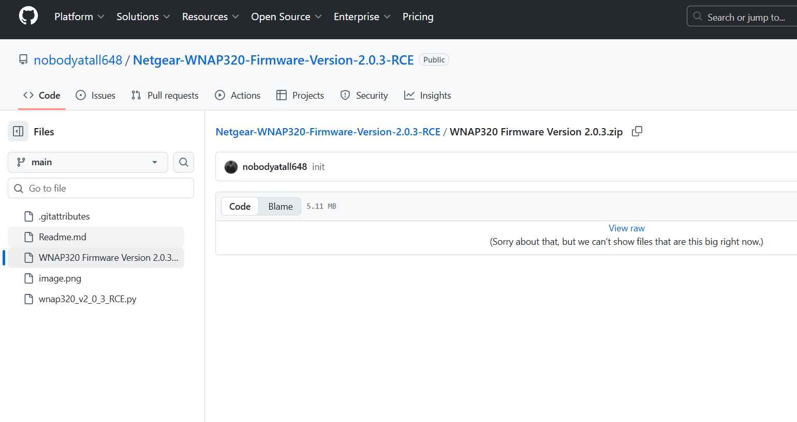
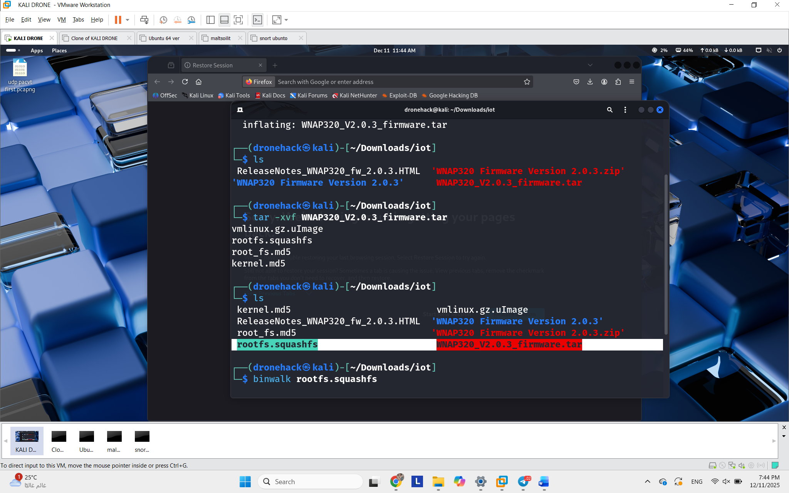
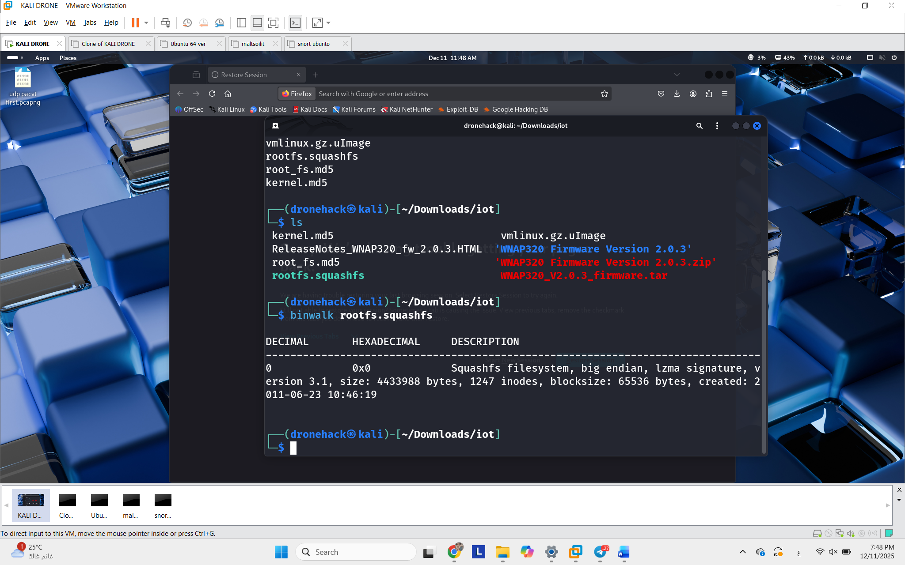
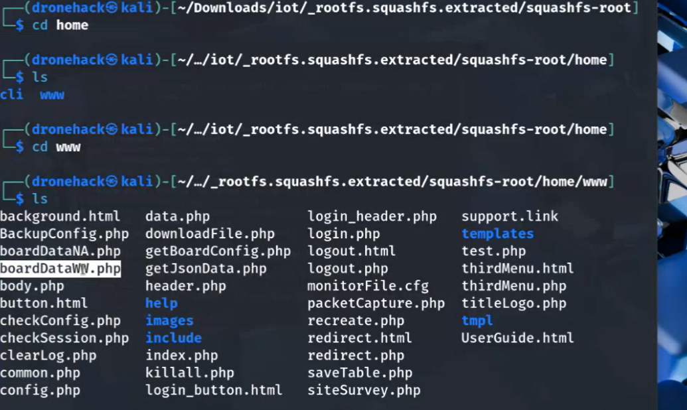
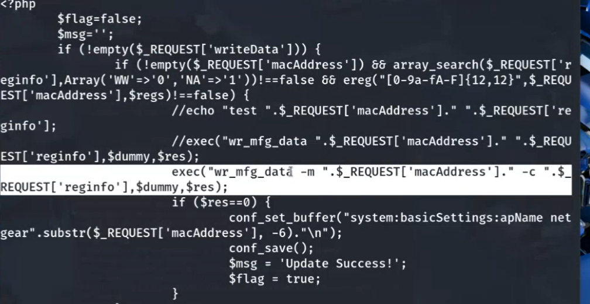

<i>Exploring security beyond the surface of connected devices.</i>

---

## 01 // Project Overview

This collaborative security project focuses on firmware analysis, reverse engineering, and vulnerability assessment of embedded devices.

We analyzed the firmware of a Netgear WNAP320 wireless access point, examined its internal file system, identified a command injection vulnerability, and validated its security impact within a controlled emulation environment.

---

## 02 // Target Device

<table>
<tr><th>Property</th><th>Details</th></tr>
<tr><td>Manufacturer</td><td>NETGEAR</td></tr>
<tr><td>Device Model</td><td>WNAP320</td></tr>
<tr><td>Device Type</td><td>Wireless Access Point</td></tr>
<tr><td>Firmware Version</td><td>2.0.3</td></tr>
<tr><td>File System</td><td>SquashFS</td></tr>
<tr><td>Vulnerability</td><td>OS Command Injection</td></tr>
<tr><td>Potential Impact</td><td>Remote Code Execution (RCE)</td></tr>
<tr><td>Testing Environment</td><td>Emulated Local Laboratory</td></tr>
</table>

---

## 03 // Project Objectives

- Analyze embedded device firmware.
- Extract and examine internal file systems.
- Identify insecure source code and configurations.
- Emulate firmware in a controlled environment.
- Validate command injection vulnerabilities.
- Assess potential security impacts.
- Recommend effective mitigation strategies.

---

## 04 // Technical Arsenal

---

## 05 // Testing Methodology

<table>
<tr><td align="center">Firmware Acquisition</td></tr>
<tr><td align="center">↓</td></tr>
<tr><td align="center">Firmware Extraction</td></tr>
<tr><td align="center">↓</td></tr>
<tr><td align="center">File System Analysis</td></tr>
<tr><td align="center">↓</td></tr>
<tr><td align="center">Source Code Review</td></tr>
<tr><td align="center">↓</td></tr>
<tr><td align="center">Firmware Emulation</td></tr>
<tr><td align="center">↓</td></tr>
<tr><td align="center">Controlled Vulnerability Testing</td></tr>
<tr><td align="center">↓</td></tr>
<tr><td align="center">Security Impact Assessment</td></tr>
</table>

---

## 06 // Firmware Analysis

### Firmware Extraction

We extracted the firmware package and examined its embedded SquashFS file system using Binwalk.

### File System Analysis

We investigated internal directories, configuration files, scripts, and web application components to understand the firmware structure.

### Source Code Review

We examined PHP source files associated with the device's web interface and identified insecure handling of user-supplied input.

### Firmware Emulation

We used Firmadyne, Firmware Analysis Toolkit, and QEMU to establish a virtual testing environment without requiring physical hardware.

---

## 07 // Vulnerability Analysis

The identified vulnerability involves insecure execution of operating system commands through the firmware's web application.

### Root Cause

- Insufficient input validation.
- Unsafe handling of user-supplied parameters.
- Insecure execution of operating system commands.

### Potential Security Impact

- Unauthorized system command execution.
- Exposure of sensitive device information.
- Unauthorized device access.
- Compromise of connected infrastructure.
- Loss of system integrity and availability.

---

## 08 // Findings and Results

The project successfully demonstrated firmware extraction, file system analysis, vulnerability identification, and command execution testing within an emulated laboratory environment.

The findings highlight the security risks associated with insecure firmware development and insufficient input validation in embedded systems.

## 08.1 // Proof of Concept

### 01 - Firmware Acquisition

We obtained the NETGEAR WNAP320 firmware for security analysis.

### 02 - Firmware Extraction

We extracted the firmware package to access its internal components.

### 03 - Binwalk Analysis

We analyzed the firmware using Binwalk to examine its embedded file system.

### 04 - File System Analysis

We examined the extracted directories, configuration files, and web application components.

### 05 - Vulnerable Source Code Analysis

We identified insecure input handling in the PHP source code that could lead to OS command injection.

---

## 09 // Technical Challenges

<table>
<tr><th>Challenge</th><th>Resolution</th></tr>
<tr><td>Tool dependency conflicts</td><td>Manual dependency configuration</td></tr>
<tr><td>Firmadyne configuration issues</td><td>Firmware Analysis Toolkit integration</td></tr>
<tr><td>Firmware emulation connectivity</td><td>Virtual network configuration</td></tr>
<tr><td>Architecture compatibility</td><td>Appropriate QEMU architecture support</td></tr>
</table>

---

## 10 // Security Recommendations

### For Manufacturers

- Implement strict server-side input validation.
- Avoid unsafe operating system command execution.
- Apply the principle of least privilege.
- Conduct firmware security testing and source code reviews.
- Provide secure and signed firmware updates.

### For Organizations

- Segment IoT devices from critical infrastructure.
- Maintain up-to-date firmware.
- Disable unnecessary services.
- Replace default credentials.
- Monitor connected device activity.
- Conduct periodic security assessments.

---

## 11 // Skills Demonstrated

---

## 12 // References

- [Binwalk](https://github.com/ReFirmLabs/binwalk)
- [Firmadyne](https://github.com/firmadyne/firmadyne)
- [Firmware Analysis Toolkit](https://github.com/attify/firmware-analysis-toolkit)
- [QEMU](https://www.qemu.org/)
- [Burp Suite Documentation](https://portswigger.net/burp/documentation)
- [MITRE CWE-78](https://cwe.mitre.org/data/definitions/78.html)

---

## 13 // Disclaimer

This collaborative security project was conducted strictly for educational and security research purposes within an authorized and controlled laboratory environment.

---

  

<i>Question everything. Trust the evidence.</i>

  

<b>M O O N W 4 R E</b>

